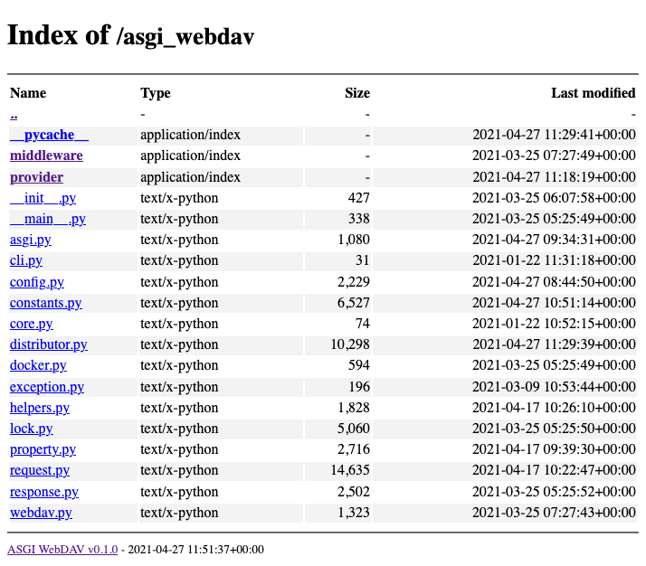

# ASGI WebDAV Server

[](https://github.com/SilviaSWR/asgi-webdav/blob/main/LICENSE)

[](https://github.com/psf/black)
[](https://github.com/SilviaSWR/asgi-webdav/actions/workflows/check-mypy.yaml)
[](https://github.com/SilviaSWR/asgi-webdav/releases)

An asynchronous WebDAV server implementation, Support multi-provider, multi-account and permission control.

> **About this fork:** this repository is an independent fork of
> [rexzhang/asgi-webdav](https://github.com/rexzhang/asgi-webdav), maintained by
> [SilviaSWR](https://github.com/SilviaSWR). The original project and documentation were created by
> Rex Zhang. The fork is not published on PyPI; install it from source or use the container image below.

## Features

- [ASGI](https://asgi.readthedocs.io) standard
- WebDAV standard: [RFC4918](https://www.ietf.org/rfc/rfc4918.txt)
- Support multi-provider: FileSystemProvider, MemoryProvider, WebHDFSProvider
- Support multi-account and permission control
- Support optional anonymous user
- Support optional home directory
- Support store password in raw/hashlib/LDAP(experimental) mode
- Full asyncio file IO
- Passed all [litmus(0.13)](http://www.webdav.org/neon/litmus) test, except 1 warning(A security alert that will not be triggered in an ASGI environment.)
- Browse the file directory in the browser
- Support HTTP Basic/Digest authentication
- Support response in Gzip/Zstd
- Compatible with macOS finder and Window10 Explorer

## Quickstart

[中文手册](https://silviaswr.github.io/asgi-webdav/zh/)

```shell
docker pull ghcr.io/silviaswr/asgi-webdav
docker run -dit --restart unless-stopped \
  -p 8000:8000 \
  -e UID=1000 -e GID=1000 \
  -v /your/data:/data \
  --name asgi-webdav ghcr.io/silviaswr/asgi-webdav
```

## Default Account

|            | value      | description                     |
| ---------- | ---------- | ------------------------------- |
| username   | `username` | -                               |
| password   | `password` | -                               |
| permission | `["+"]`    | Allow access to all directories |

## View in Browser



## Documentation

[Documentation at GitHub Page](https://silviaswr.github.io/asgi-webdav/)

## Contributing

Please refer to the [Contributing](docs/contributing.en.md) for more information.

## Acknowledgements

Please refer to the [Acknowledgements](docs/acknowledgements.md) for more information.

## Related Projects

- <https://github.com/bootrino/reactoxide>
